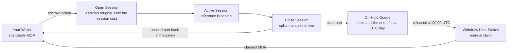

If you've opened a session and watched a much larger MOR amount than expected disappear
from your wallet, this page explains exactly what happened and why — with real,
verified transaction data, not just the theory.

**This applies to every Native path setup** — Desktop App, morctl, headless router, or
running a provider. The mechanics are identical regardless of which client opened the
session.

---

## The Mental Model

Three terms, easy to conflate, worth fixing in your head first:

| Term | What it means | Scale |
|---|---|---|
| **Cost** | `pricePerSecond × duration` — what the session actually costs | Small |
| **Escrow** | MOR locked at session open to guarantee that cost | **~338× the cost** |
| **Claim** | Calling `withdrawUserStakes` to move released escrow back into spendable balance | — |

**The one sentence that matters most:** opening a session *escrows* MOR — it does not
spend it. But the escrow is the large ~338× number, not the small cost. The real
constraint on how much MOR you need to hold is **capital float** (what's locked in
escrow while sessions are open), not the session's actual price.

<Note>
The exact multiplier floats with network emissions and supply — check current values
at [tech.mor.org/calc.html](https://tech.mor.org/calc.html) rather than treating ~338×
as fixed.
</Note>

You don't have to work the multiplier out yourself. The desktop app (MorpheusUI) shows
both numbers on its confirm screen before you open a session: the MOR to be locked,
and the compute cost. If you use the router API directly,
`GET /blockchain/models/<MODEL_ID>/session/estimate` returns the same two figures.

---

## The Session Lifecycle

1. You (or your client) open a session — MOR is escrowed.
2. If a session for the same model is already open on-chain, most clients **adopt** it
   instead of opening a new one — no new escrow, no new MOR needed.
3. The session serves inference until its duration ends.
4. On close (automatic ~1 minute after expiry, or manual), the session settles.

Adoption matters in practice: if a client crashes or restarts while a session is still
open on-chain, a well-behaved client re-discovers and reuses it rather than opening a
second one and stranding the first session's escrow.

### The Flow, Visualized

The confusing part isn't the steps — it's that MOR leaves your wallet on one path and
comes back on **two different paths**. This is that flow:



How the stake splits depends on how long the session ran. Close early, and most of it
takes the top path straight back to your wallet. Let the session run its full length,
and almost all of it is "used" — the top path carries only a sliver, and the rest goes
the long way round through the on-hold queue. The real transactions below are
full-length sessions, which is why the split looks so lopsided.

---

## What Happens When a Session Closes — Verified

This is the part that causes real confusion, so it's worth showing the actual numbers
rather than just describing them.

<Warning>
**Closing a session doesn't return all of your stake right away.** Only the
**unused** part comes back in the close transaction. The part that covered the time
you used is held until the end of that UTC day, then needs a separate claim — see
[Claiming Your Stake Back](#claiming-your-stake-back) below.
</Warning>

### Real example — three sessions, same wallet

```
07:15:47  Open Session    1.18204 MOR escrowed
07:19:37  Open Session    1.18204 MOR escrowed
07:20:35  Open Session   11.34756 MOR escrowed
07:23:15  Close Session   0.00295 MOR returned   (session 1)
07:27:15  Close Session   0.00295 MOR returned   (session 2)
07:31:15  Close Session   0.01891 MOR returned   (session 3)
```

Each `Close Session` transaction returned only a fraction of a percent of what was
escrowed. These sessions ran to their end (each close came about a minute after the
session expired), so almost all of each stake counted as used — what came back is a
sliver of unused headroom. The rest — roughly **13.7 MOR** across these three
sessions — stayed locked after closing.

### Does closing and reopening let you reuse the same escrow? No — verified directly.

A common assumption is that once a session closes, its escrow becomes available for
your *next* session. It doesn't. Real evidence, a clean close-then-reopen sequence:

```
08:22:17  Open    7.54616 MOR escrowed
08:36:23  Close   0.00897 MOR returned
08:43:03  Open   11.27275 MOR escrowed   ← a completely NEW escrow, 7 minutes later
08:53:25  Close   0.01877 MOR returned
```

If the first session's escrow were reusable, the second open should have drawn on the
~7.55 MOR from the first session. It didn't — that MOR was on hold, so the second open
escrowed a separate 11.27 MOR. **Each session open requires its own fresh capital**,
regardless of what's pending from a prior session's close.

### So where did the rest of the escrow go?

Into an on-hold queue. It's released at the end of the UTC day the session ended — the
contract's rule is `releaseAt = startOfDay(min(closedAt, endsAt)) + 1 day` — so the
wait is anywhere from minutes (a session that ends just before midnight UTC) to about
24 hours. After that it sits in the queue until you claim it. Until claimed, that MOR
is **not** spendable, including as escrow for a new session.

<Note>
**One exception:** if the close transaction itself lands after `releaseAt` — for
example, your node was offline when the session expired and closed it the next day —
everything comes back in the close, with nothing held.
</Note>

<Tip>
If you're running multiple sessions or automating session management, budget your
liquid MOR for the **largest single session's escrow you'll have open at once**, plus
enough for the next one — not for your cumulative daily usage. Usage cost is small;
capital float is the real number that matters.
</Tip>

### What about closing early?

Closing early doesn't cost you anything. The unused part of the stake — most of it, if
you close well before the end — comes straight back in the close transaction. Only the
part that covered the time you actually used goes on hold. The one real trade-off: if
you then open a new session, it needs its own fresh escrow, because the held part
isn't spendable until you claim it.

---

## Claiming Your Stake Back

There's no claim button in MorpheusUI yet. Once the hold has passed, you claim from
your node's API or from the contract directly.

**See where your MOR is first (read-only).** Enter your wallet address at
[tech.mor.org/session.html](https://tech.mor.org/session.html). It splits your MOR
into what's in your wallet, what's locked in active sessions, and what's on hold. It
only shows you — it doesn't claim anything.

**Claim through your node** (router v7.11.0 or newer). Run these from the directory
that holds your router's `.cookie` file:

```bash
# Check what's on hold and what's claimable now
curl -s "http://localhost:8082/blockchain/stakes/onhold" -u "$(cat .cookie)"
# → {"available": "<claimable now, wei>", "hold": "<still locked, wei>"}

# Claim everything that's available
curl -s -X POST http://localhost:8082/blockchain/stakes/withdraw \
  -H 'Content-Type: application/json' \
  -u "$(cat .cookie)" \
  -d '{"iterations": 20}'
# → {"tx": "0x..."}
```

`iterations` is how many on-hold entries the contract works through in one call — 20
is plenty for normal use.

**Or call the contract directly.** `withdrawUserStakes` on the Diamond contract
(`0x6aBE1d282f72B474E54527D93b979A4f64d3030a`) does the same thing, signed by your
wallet — for example through
[Basescan's Write tab](https://basescan.org/address/0x6aBE1d282f72B474E54527D93b979A4f64d3030a#writeContract).

Either way, the transaction to look for afterwards is `Withdraw User Stakes` — see
below.

---

## Verifying It Yourself, On-Chain

Don't take a client's balance readout as the full picture — the transaction history
itself is the ground truth. Here's how to check.

<Steps>
  <Step title="Find your wallet's transaction history">

Go to `https://basescan.org/address/<your-wallet-address>` and export the token
transfer history, or browse it directly.

  </Step>
  <Step title="Identify the transaction types">

Look for these method names against the Diamond contract
(`0x6aBE1d282f72B474E54527D93b979A4f64d3030a`):

| Method | What it means |
|---|---|
| `Open Session` | MOR moved from your wallet into escrow |
| `Close Session` | The unused part of the stake returned to your wallet — only a sliver if the session ran its full length |
| `Withdraw User Stakes` | The claim — this is what returns the held part, usually the bulk of your MOR |

  </Step>
  <Step title="Match amounts and timestamps">

Compare each `Open Session` amount against its corresponding `Close Session` amount.
If the session ran its full length and the amount returned is a small fraction of
what was escrowed, that's expected — the rest is waiting in the on-hold queue for a
`Withdraw User Stakes` claim. If you closed early, expect a much bigger return at
close.

  </Step>
</Steps>

**Other useful tools:**
- Live active-model registry: [active.mor.org/active_models.json](https://active.mor.org/active_models.json)
- Escrow/stipend calculator: [tech.mor.org/calc.html](https://tech.mor.org/calc.html)

---

## FAQ: Will My Conversation Get Cut Off When a Session Ends?

**No.** This is worth stating explicitly, since it's a common concern.

A Morpheus session is a transport-level inference channel, not conversational state.

- Your conversation (message history, context) lives in your **client** (the Desktop
  App, morctl, your own tooling) — not in the session itself.
- The session is just an open pipe to a provider that can run inference.
- When a session ends and a new one opens, your client still holds the full
  conversation and sends it to whichever session is currently active.
- From your perspective, a session swap is invisible — the conversation continues
  seamlessly.

Nothing in the session lifecycle truncates or resets your conversation. Short sessions
never cost you conversation continuity.

---

## Common Misconceptions

<AccordionGroup>
  <Accordion title="Escrow is reusable within the same day">
    **Reality:** it isn't. Verified directly against on-chain transaction history
    across two independent test sessions (see "What Happens When a Session Closes"
    above). Each session open requires its own fresh escrow — the held part of a
    closed session's stake isn't spendable again until the hold passes and you claim
    it.
  </Accordion>
  <Accordion title="Closing a session returns all your money">
    **Reality:** it returns only the unused part of the stake. The part that covered
    the time you used moves to an on-hold queue until the end of that UTC day, then
    needs a separate `withdrawUserStakes` claim.
  </Accordion>
  <Accordion title="Closing a session early loses you money">
    **Reality:** it doesn't. Closing early returns the unused part of the stake
    immediately — more than you'd get back at close if you let the session run out.
    The only trade-off is that a new session needs its own fresh escrow.
  </Accordion>
  <Accordion title="Asking the model what model it is confirms what's actually running">
    **Reality:** models frequently misreport their own identity. Trust the API
    response's `model` field or your client's status output, not the model's
    self-description.
  </Accordion>
</AccordionGroup>
